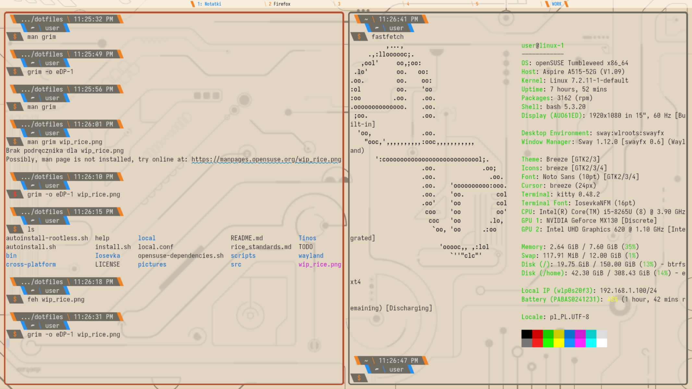

# Chlebqowy Dotfiles

> [!NOTE]
> AI has been used a bit in this project but all design choices were done by me. [Click here for more info](#ai-disclosure)

## Currently includes
- sway-fx
- starship
- kitty
- rofi
- dunst
- fontconfig
- micro
- swaybar
- regreet
- grub 
## Features
- Custom bars
- Nice light theme that also focuses on usability
## Keybinds
- All keybinds follow simple patterns such as all system shortcuts starting with super.
### Essential shortcuts:
- Windows can be moved or focused with `Super` + `↑`/`←`/`↓`/`→` or `w`/`a`/`s`/`d`.
- Resizing is done with `Super` + `+` / `-` and `Super` + `Shift` + `+` / `-`
- The terminal is opened with `Super` + `Enter`, Firefox with `Super`+`Shift`+`Enter` and the launcher with `Super` + `i`
- You can focus on the left monitor with `Ctrl` + `Super` + `Left` and on the right with `Ctrl` + `Super` + `Right`

_Please read the [`sway`](wayland/sway/config) config to learn more

## How to install
1. Make sure all dependencies are installed.
2. Read `install.sh`, `autoinstall.sh` or `autoinstall-rootless.sh`.
3. Run `bash install.sh` (or whichever script you decide to use).

> [!NOTE]
> I recommend modifying niri and i3 files to reflect your monitor setup
  
## Dependencies    
Starship, kitty, dunst, micro-editor    
sway-fx, swaybg, nvidia-smi, swaybar, rofi,
nlohmann_json-devel (workspace-bar), g++, make

On opensuse you can automatically install them with `bash opensuse-dependencies.sh` (Also adds my obs repo)

## Configuration
You have to modify the config files manually, although they are fairly simple.  
Some resources I'd recommend are the wikis for each project, such as:  
[starship](https://starship.rs/config/), man pages [dunst](https://man.archlinux.org/man/dunst.5.en) and the [i3wm userguide](https://i3wm.org/docs/userguide.html).  

> [!NOTE]
> This rice is not finished yet
> Check missing features [here](TODO)

## Contributing  
__Please open an issue if something is broken. Format the issue however you want.__  
_I generally don't accept pull requests_, but I'd welcome AMD/Intel GPU support.  
Feature requests are fine.

## Credits  
- [i3wm](https://i3wm.org) for getting me into ricing  
- Every project for which configs I included  

## AI Disclosure
ChatGPT and Claude helped me when I couldn't find docs, so fontconfig and getting the sway IPC  
This readme hasn't been AI generated but I've had a model proofread it.  

## License
[MIT](LICENSE) for the configs, scripts and my code  
